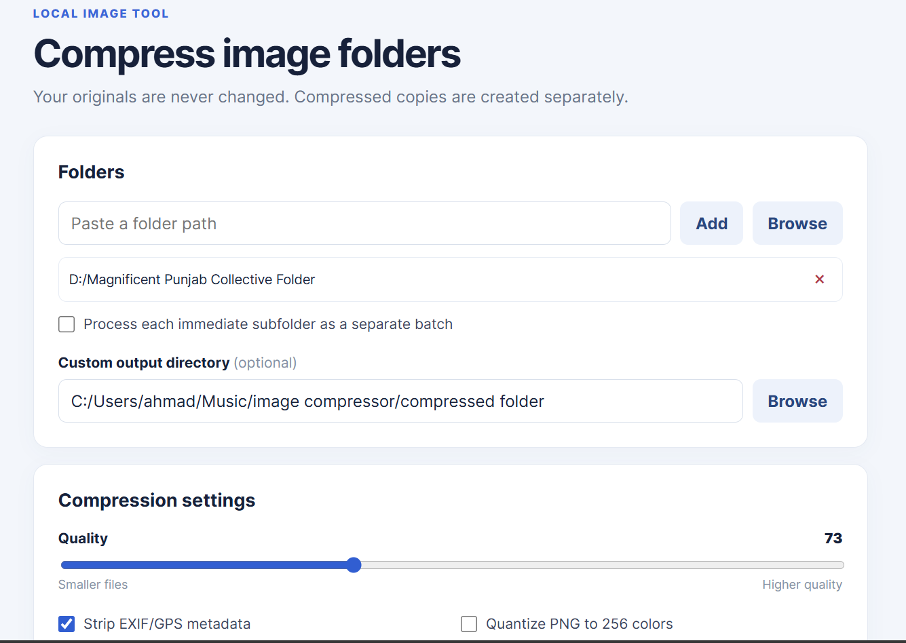
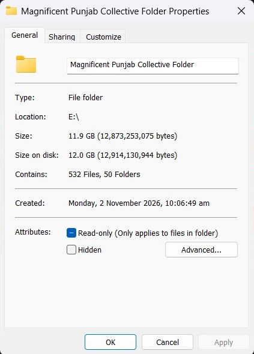
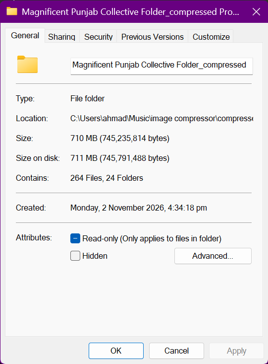

<div align="center">

# Local Image Batch Compressor

**Shrink image folders in bulk. Keep your originals safe.**

A simple, local-first Flask app for compressing images and preserving the folder structure. No uploads, no cloud processing, and no changes to your source files.

[](https://www.python.org/)
[](https://flask.palletsprojects.com/)
[](https://python-pillow.org/)

</div>

## Preview



## Before and after

The sample images below show the visual output. The folder screenshots show the corresponding Windows properties before and after compression.

<p align="center">
  
  
</p>
<p align="center"><em>Before</em> &nbsp; · &nbsp; <em>After</em></p>

<p align="center">
  
  
</p>
<p align="center"><em>Original folder</em> &nbsp; · &nbsp; <em>Compressed folder</em></p>

## Features

- Compress multiple folders and keep their nested directory structure.
- Choose whether each immediate subfolder is processed as a separate batch.
- Adjust image quality and optionally resize images to a maximum dimension.
- Optimize JPEG, PNG, and WebP images; optional HEIC/HEIF support is available with `pillow-heif`.
- Optionally strip EXIF/GPS metadata, quantize PNGs, or copy non-image files.
- View live progress and a report with file totals, space saved, and any failures.
- Keep original files untouched. If compression would make an image larger, the original is copied to the output instead.
- Run locally on your machine; images are not uploaded to a service.

## Get started

Requires Python 3.10 or newer.

```powershell
git clone https://github.com/KahafSameer/Image-Compressor-with-folders.git
cd Image-Compressor-with-folders
py -m venv .venv
.\.venv\Scripts\Activate.ps1
python -m pip install -r requirements.txt
python app.py
```

Open <http://127.0.0.1:5000> in your browser. Add folders by pasting a path or using **Browse**, choose your settings, and select **Start**.

By default, the app creates a new `folder_compressed` directory beside each source folder. If that name already exists, it uses a numbered suffix. You can also choose an existing custom output directory in the app.

## Command line

Compress one or more folders without opening the web interface:

```powershell
python compressor.py "C:\photos\trip" "D:\archive\scans" --quality 82 --max-size 1920
```

Available options:

| Option | Description |
| --- | --- |
| `--quality 60-95` | JPEG/WebP quality; defaults to `82`. |
| `--max-size PIXELS` | Fit images within this maximum width and height; resizing is off by default. |
| `--output-dir PATH` | Save output folders in an existing directory. |
| `--keep-metadata` | Preserve EXIF metadata; metadata is stripped by default. |
| `--quantize-png` | Reduce PNGs to a palette of up to 256 colors. |
| `--copy-non-images` | Copy non-image files into the output folder. |

## Compression details

- JPEGs are optimized and saved progressively; WebP images use the selected quality and encoder optimization.
- PNGs use lossless optimization unless color quantization is enabled.
- Supported formats are JPEG, PNG, and WebP. Install `pillow-heif` to add HEIC/HEIF support:
  ```powershell
  python -m pip install pillow-heif
  ```
- Unsupported files are skipped unless **Copy non-image files** is enabled. Corrupt images are reported without stopping the whole batch.
- Folder processing uses worker processes to handle images concurrently.

## Run tests

```powershell
python -m unittest discover -s tests -v
```

## Generated files

Compressed output is written to `compressed folder/` in this workspace, and that directory is excluded by `.gitignore`. Keep generated image batches out of Git; the screenshots and sample before/after images above are separate files used by this README.
